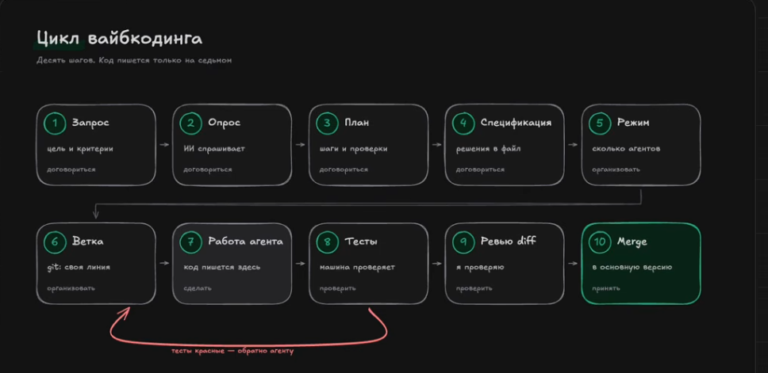

# Кодинг с ИИ: как не словить техдолг и делать нормально

**Коротко:** ИИ ускоряет написание кода, но само по себе это ничего не значит. Вопрос не в том, быстрее ли ты пишешь, а в том, что остаётся после: переделки, копипаста, «оно у меня работало» — или код, который живёт месяцами.

Если читать только одно — вот главное:

> **ИИ делает тебя быстрее ровно настолько, насколько ты умеешь проверять.** Код от ИИ — это черновик, который прошёл ревью. Не приговор, не истина, не «готово».

---
## 0. Минимальный цикл агентной разработки

 

## 1. Сначала факты: что реально происходит

Не верь рекламе — посмотри на измерения. Свежие цифры из публичных исследований 2024–2026 (ссылки в конце):

- **Быстрее — да.** В контролируемых экспериментах с Copilot разработчики выполняли типовые задачи до ~50% быстрее (GitHub/Microsoft). Уберовское исследование 2025: +19% скорости — но при этом **+41% багов** в коде, который попал в main. Быстро и качественно поехали в разные стороны.
- **Писать стали больше — поставлять не стали.** Гарвардская рабочая бумага 2026 (718 компаний, 725 тыс. работников, телеметрия 2021–2026): после внедрения кодинг-агентов код на разработчика вырос на ~30%, коммитов +20%, PR +23% — а объём поставленного софта статистически не изменился. Зато PR до слияния стал ждать на 49% дольше, доля PR, отправленных на доработку, почти удвоилась, комментариев в ревью на 35% больше. Вывод авторов короткий: «бутылочное горлышко переместилось из написания кода в его проверку». Bain (2026, ~300 техлидеров) подтверждает с другой стороны: задач стало +21%, времени на ревью — +91%, а компании захватывают лишь 20–27% ожидаемого выигрыша вместо ~95–148%.
- **Качество кода падает без контроля.** GitClear прогнал анализ по 211 млн строк: код, написанный с ИИ, чаще переделывают (churn вырос на ~39%), в нём больше копипасты, меньше рефакторинга и переиспользования. По другим оценкам дублирование выросло на десятки процентов, а повторное использование упало.
- **Техдолг измерили точнее.** GitClear (июнь 2026, 623 млн изменений, ~25% коммитов уже несут след ИИ): рефакторинг упал на 70% — с 21% переписываемых строк в 2022-м до 3,8% в 2026-м, дублирование +81%, копипаста +41%, catch-блоки-«глушилки» ошибок +47%.
- **ИИ прячет ошибки, а не чинит.** Сильно выросла доля кода, который «ловит» исключение и идёт дальше, не разобравшись в причине — это самый коварный вид бага: приложение «работает», а почему — никто не знает.
- **ИИ не учит: навыки падают.** Рандомизированный эксперимент Anthropic (52 разработчика, новая библиотека, январь 2026): группа с ИИ набрала 50% на тесте понимания против 67% у группы «руками» — минус 17 пунктов, почти две оценки; разрыв максимален на задачах отладки (а отладка и есть проверка чужого кода). Выигрыш по времени — пара минут, статистически незначим. Нюанс: те, кто использовал ИИ как «объяснялку» (просили пояснения, задавали вопросы), учились не хуже. Делегирование ускоряет, но не прокачивает.
- **Проверка стала платной — verification tax.** DORA (Google Cloud, апрель 2026) назвала это прямо: главные расходы теперь не на написание кода, а на проверку, что он верен и безопасен. Отсюда и J-кривая: первые ~3 месяца внедрения продуктивность падает (~−15%), пока команда учится проверять. Телеметрия Code Ninety (84 компании, 14 200 разработчиков, 2025–2026): lead time PR −32%, но дефекты +50%, переделка кода за 30 дней +68%, время ревью +42%, флаги безопасности +61%. И главное: команды с автоматическими гвардрейлами и TDD сохраняют почти весь выигрыш (−45%) и срезают ~80% штрафа. Разрыв «быстро ↔ качественно» — не свойство ИИ, а свойство процесса.
- **Ревью-агенты пока не спасают.** Faros AI (2026, 22 тыс. разработчиков): высокая доля ИИ-кода → PR крупнее на 51%, багов на разработчика +54%. LinearB (8,1 млн PR): PR от ИИ ждут первого ревью в 4,6 раза дольше. Первый бенчмарк ревью-агентов (GitHub ReviewBench, октябрь 2026): лучший ИИ-ревьюер ловит ~40% замечаний. К марту 2026 ИИ-ревью включили 80% компаний — но только 23% комментариев в ревью пишет ИИ.
- **Open Source захлёбывается «ИИ-мусором».** Linux Foundation (2026): GenAI ускоряет написание кода на 52%, но ~25% входящих PR мейнтейнеры считают низкокачественным «ИИ-мусором» (в крупных проектах — до 31%). 59% мейнтейнеров отмечают рост потока PR, 71% — что порог входа снизился, и лишь 53% — что доверие к сообществу выросло. Правила использования GenAI есть только у 35% проектов. Зато 66% разработчиков тратят сэкономленное время на разбор техдолга.
- **Это уже не игрушки.** В 2025-м в крупных компаниях ~22% кода в main написал ИИ; к 2026-му ~25% коммитов несут измеримый след ИИ (GitClear), а организационное внедрение ИИ достигло 88% (Stanford AI Index 2026). Опрос Stack Overflow (2026, 30 тыс. разработчиков): 73% тех, кто пользуется ИИ-ассистентами, — каждый день, треть ежедневных пользователей сидит в них 4+ часа; в приоритете агенты (66%) и чат-боты (63%). Показательно и то, где ИИ *не* используют: продакшену его доверяют только 20%. Поэтому компании вешают метрики (сколько кода переписывается, сколько дублируется) прямо в CI — без приборной доски эрозия незаметна.
- **Корпорации сами в ИИ — по их собственным отчётам.** Google: Пичаи, апрель 2026 — ИИ пишет ~75% нового кода (в октябре 2024-го было 25%); работа инженера в основном сводится к ревью и приёмке. Microsoft: ~30% мержимого кода сгенерировано ИИ (Наделла, конец 2025). Anthropic — самый яркий случай: по эссе «When AI builds itself» (июнь 2026) Claude написал >80% продакшн-кода, по данным S-1 (октябрь 2026) — уже >90%; в Q2 2026 инженер мержил в среднем в 8 раз больше кода в день, чем в 2024-м. Компания сама оговаривается: цифра «почти наверняка завышает реальный рост продуктивности». Оговорка важная: корпоративные отчёты — не независимые измерения, у вендоров есть мотивация быть громче. Зато цифры с другой стороны уравнения тоже пришли: по опросу 2026-го примерно каждый пятый CISO уже сталкивался с инцидентом, связанным с ИИ-кодом.

**Вывод простой:** скорость даёт генерация. Качество — всё, что вокруг неё: тесты, ревью, маленькие шаги и умение читать код. Данные 2026 расставили приоритеты окончательно: узкое место больше не в написании кода, а в его проверке. Генерация растёт как угодно быстро — поставляется ровно столько, сколько люди успевают понять, отревьюить и протестировать. И помни про J-кривую: первые месяцы после внедрения обычно медленнее, чем раньше, — пока навык проверки догоняет скорость генерации.

## 2. Что убивает качество (антипаттерны)

Все эти штуки выглядят безобидно — поэтому они и опасны. Узнаёшь себя? Ну, хотя бы пару пунктов — уже неплохо.

**«Напиши мне модуль целиком».**
Просишь агента родить сразу весь модуль — получаешь красивую простыню на 300 строк. Внутри неё спокойно лежат 2–3 ошибки, но найти их в простыне ты не будешь — это же агент писал, он же умный. Так рождаются баги, о которых узнают через месяц, в проде.
*Почему так: большая генерация = большой непроверенный кусок. Чем больше кусок — тем меньше шансов, что его вообще кто-то прочитал.*

**Верить на слово.**
«Агент сказал, что тесты проходят» — отлично, значит, можно сдавать? Нельзя. Иногда он просто не запускал их. Иногда запускал, но не те. Правило простое: верь не выводам, а повторённому запуску. Команду вставил, прогнал сам, увидел зелёный — вот теперь можно верить.

**Копипаста вместо рефакторинга.**
Агент легко предложит третью функцию `get_loans_in_range` рядом с первой и второй, потому что не видит контекст или ему лень. Дублирование — самый частый вид техдолга от ИИ. Две почти одинаковые функции вместо одной — это не «гибкость», это две точки, где будут править баг отдельно.

**Тесты «потом».**
Если тестов нет, агенту нечего подтверждать: он напишет уверенный вывод — и будет прав по форме. Тест — это не формальность, это способ объяснить агенту, что вообще считается «работает». Без теста ты уже не поймёшь, что сломал.

**Спека — это два слова в чате.**
«Сделай выдачу оборудования» — и понеслось. Через час выясняется, что «выдача» включала и лимиты, и просрочку, и возврат, а агент сделал только happy path. Если написать заранее 3–5 предложений «что делаем и что *не* делаем», переделок в разы меньше.

**Безопасность «на потом».**
Агент с радостью предложит «проверенный» пакет из интернета и посоветует положить ключ прямо в код — «так проще». Это то, что потом аудиторы показывают пальцем. Секреты, инъекции, Supply Chain — темы не скучные, а дорогие. Коротко: ключ не в код; пакет — проверь; SQL — не строкой.

## 3. Как реально лучше (то, что работает)

Не «идеальный процесс из книжки», а то, что на практике даёт код, который не стыдно отдать. Всё это уже разобрано в материалах модуля — здесь сжатая выжимка.

**1. Маленькие шаги, а не «весь модуль».**
Одна функция, один сценарий, один PR — а не «напиши всё». Агент хорош на кусках: «напиши функцию по этому контракту, вот тест». Каждый кусок легко проверить, а где легко проверить — там редко живут скрытые баги. Большая задача делится на шаги на бумаге, а не в голове у агента.

**2. Спека до кода.**
Пять минут на 3–5 предложений: что делаем, какие правила, что *не входит*. Это же даёт тебе и агенту общий словарь. В курсе это называется SDD — и это самый дешёвый способ сэкономить час переделок. Спорить с агентом о правилах до кода — дёшево; переписывать код после — дорого.

**3. Тест — это контракт.**
Сначала тест (или хотя бы пример приёмки), потом реализация. Тест упал → код появился → тест зелёный → шаг готов. Если не можешь показать, что тест реально падает без кода — ты не в TDD, ты в «агент рассказал сказку». Красный тест перед зелёным — это не ритуал, это доказательство, что тест вообще что-то проверяет.

**4. Человек — архитектор и ревьюер.**
Решения, которые влияют на всё: где границы, как называются вещи, какие правила в домене, что не делаем никогда — принимает человек. Агент исполняет. Не потому что «человек умнее», а потому что агент живёт моментом и не помнит, зачем ты начал проект.

**5. Ревью, а не доверие.**
Два уровня: отдельный агент-ревьюер (свежие глаза, свои правила проверки) + собственные глаза. Ревью — это не «полистать», а пройтись по коду построчно и спросить себя: «я это понимаю? я это переживу через три месяца?». Агент-ревьюер ловит контракты и забытые края; человек ставит вердикт — потому что смысл задачи знает только он.

**6. Читай сгенерированное, как чужой PR.**
Никто не читает свой код так внимательно, как чужой. Подход «агент написал — значит моё» даёт дыры. «Агент написал — значит чужое, пока не прочитал построчно» — даёт чисто. Разница в одной строчке мыслей, а эффект в половине багов.

**7. Отладка — часть работы.**
Код от ИИ падает. Это не баг курса, это природа. Поэтому умение читать трейсбек, ставить `breakpoint()`, крутить отладчик и биссектить проблему важнее умения «попросить красивее». Пока агент «подумает и исправит», ты уже поймёшь причину сам. Отладка — не признак провала, а признак взрослого подхода.

**8. Дай агенту нормальный контекст (harness).**
Агент хорош ровно настолько, насколько хорошо он видит: что за проект, какие правила, какие примеры, какие файлы трогать нельзя. Собрать это в одном месте — файлы с инструкциями проекта, пакеты навыков, инструменты — это и есть harness. В курсе это части 3–4 (skills и MCP): они не про «модно», они про то, чтобы агент не сочинял контекст за тебя.

**9. Следи за техдолгом: churn и копипаста.**
Churn — сколько раз ты переписываешь свежий код. Растёт — значит, генерация опережает понимание. Копипаста растёт — значит, рефакторинг откладывается. Противоядие скучное и рабочее: раз в неделю-две — сессия чистки (слить дубли, назвать вещи, удалить мёртвый код). Плюс линтеры, типы и статический анализ — они ловят то, что ты устал ловить глазами.

**10. Безопасность — не «на потом».**
Три правила на всё: секреты не в коде (ключи — в переменные окружения, а не в `config.py`), зависимости — только проверенные, инъекции — не собирать строки с пользовательским вводом. Агент предложит нарушить — уточни правило. Это 10 минут работы сейчас против многодневного разбора полётов потом.

## 4. Пять правил на холодильник

1. **Маленький шаг → тест → код → ревью.** В этом порядке, не наоборот.
2. **Сначала спека, потом код.** Пять предложений в начале экономят час в конце.
3. **Не верь выводам — верь запускам.** Запусти сам, увидь зелёный, только потом говори «работает».
4. **Читай сгенерированное как чужой PR.** Внимательно, построчно, с вопросом «а это я переживу через три месяца?».
5. **Рефактори и подметай.** Чистка кода — это работа, а не «когда-нибудь потом».

## 5. Если совсем коротко

Кодинг с ИИ — это не «дать агенту задачу и получить результат». Это **дартс с партнёром: ты целишься, агент бросает, ты судишь попадание** и имеешь право попросить перебросить. Убрать из этой схемы прицеливание и судейство — останется случайное бросание.

Хорошие новости: всё, что нужно для судейства, — обычные навыки разработки: читать код, писать тесты, ревьюить, делить задачу на шаги. ИИ не отменяет эти навыки — он делает их **важнее**, потому что без них объём «правдоподобно выглядящего» кода завалит кого угодно.

Агент — быстрый исполнитель. Качество — то, что ты делаешь вокруг него.

## 6. Куда дальше в этом модуле

- `01-tdd-python.md` — как тест превращается в контракт (правила 1 и 3).
- `02-ddd-python.md`, `03-solid-python.md` — где брать «границы» и «правила» для спеки (правило 2 и 4).
- `04-mvc-python.md`, `05-clean-architecture-python.md` — как не дать коду превратиться в кашу (правило 4 и 9).
- `ai-assisted-software-development.md` — полная карта подходов и практический цикл разработки с ИИ.
- `practicum-python-ai-development.md` — LabLend: на нём всё вышеперечисленное отрабатывается руками, с агентным ревью на каждой итерации.

## Источники (цифры из разделов 1 и 3)

- GitHub/Microsoft: контролируемые испытания Copilot (ускорение ~50% на типовых задачах).
- Uber/Stanford (2025): разработчики на 19% быстрее, +41% багов в merged-коде.
- GitClear (2025), анализ 211 млн строк: churn +39%, рост копипасты, падение рефакторинга и переиспользования.
- LeadDev/DevClass (2025): рост дублирования и «кода-заглушек, глотающих ошибки» (+47%), падение reuse (−70%).
- DX (Q4 2025), 135 тыс. разработчиков: ~22% merged-кода авторства ИИ в крупных компаниях.

### Свежее: 2026

- Chen & Stratton (Harvard, 2026). «Artificial Intelligence in the Firm: Bottlenecks in Software Production» — рабочая бумага по телеметрии 718 компаний (725 тыс. работников, 2021 – март 2026); сводка Ars Technica, октябрь 2026.
- Bain (2026), Global Technology Report: ~300 старших техлидеров; +21% задач, +91% времени на ревью, захвачено 20–27% ожидаемого выигрыша.
- Anthropic (январь 2026). «How AI assistance impacts the formation of coding skills» — РКИ, 52 разработчика; 50% vs 67% на тесте понимания. anthropic.com/research/AI-assistance-coding-skills (arXiv:2601.20245).
- Google Cloud DORA (апрель 2026). «The ROI of AI-assisted Software Development» — J-кривая, «verification tax», ROI-калькулятор.
- Code Ninety (февраль–август 2026). «Developer Productivity & AI-Generated Tech Debt Index 2026» — телеметрия 84 компаний, 14 200+ разработчиков, Q1 2025 – Q1 2026.
- GitClear (июнь 2026). «The Maintainability Gap» — 623 млн изменений кода 2023–2026: рефакторинг −70%, дублирование +81%, копипаста +41%, глушилки ошибок +47%.
- Linux Foundation (2026). «Open Source Software Development in the GenAI Era» (All Things Open 2026): −52% времени на код, ~25% PR — «ИИ-мусор».
- Stack Overflow (октябрь 2026): Developer Survey 2026, 30 000+ респондентов; 73% пользователей ИИ — ежедневно, агенты 66% / чат-боты 63%, продакшену доверяют 20%.
- Google (Pichai, апрель 2026): ~75% нового кода генерируется ИИ (октябрь 2024 — >25%); сводка Mathrubhumi.
- Microsoft (Nadella, Q1 FY2026, октябрь 2025): ~30% мержимого кода сгенерировано ИИ.
- Anthropic (2026): эссе «When AI builds itself» (июнь 2026) и S-1 (октябрь 2026): Claude пишет >80% → >90% продакшн-кода, ×8 кода в день (с оговоркой самой компании); опрос CISO: ~1 из 5 уже имел инцидент с ИИ-кодом (сводка BitsMinds, июнь 2026).
- Stanford HAI (апрель 2026): AI Index 2026 — организационное внедрение ИИ 88%, рост задокументированных ИИ-инцидентов 233 → 362 (+55%).
