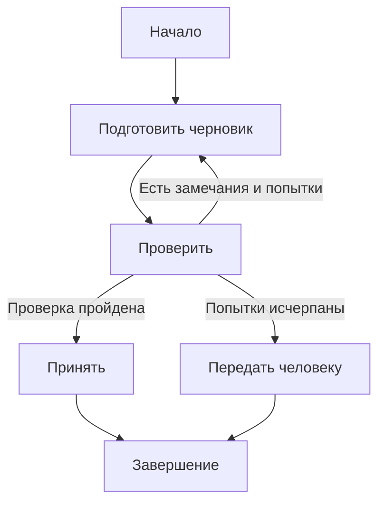
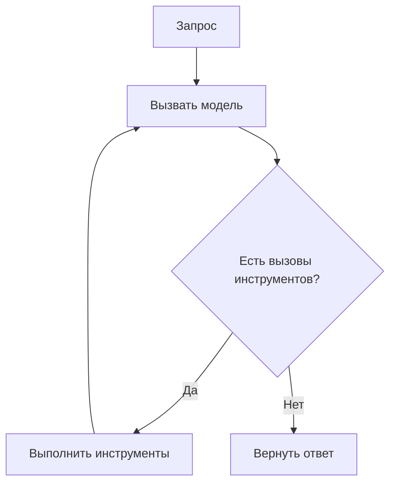

# LangGraph: управление выполнением ИИ-приложений

Учебный материал для курса по ИИ. Проверка документации: 30 октября 2026 года.

**Предварительные знания:** функции, словари и аннотации типов Python; базовое понимание вызова LLM через API. Знакомство с tool calling желательно, но для первого примера не требуется.

**После изучения материала вы сможете:** объяснить назначение LangGraph, описать процесс через состояние и переходы, собрать граф с циклом, отличить сохранение состояния от памяти модели и определить, когда фреймворк оправдан.

## 1. Что такое LangGraph

**LangGraph — библиотека и среда выполнения для процессов с состоянием, ветвлениями и циклами. Её используют для оркестрации ИИ-агентов и других многошаговых приложений.**

Оркестрация означает управление тем, какой шаг выполнить, какие данные ему передать и куда перейти после получения результата. Шагом может быть вызов LLM, обычная Python-функция, обращение к БД или ожидание решения человека.

LangGraph не является языковой моделью и не обучает модели. Он организует выполнение программы, внутри которой можно вызывать модели. Использовать его можно локально; сервис LangSmith не является обязательным условием работы библиотеки. Основной предмет этого материала — Python Graph API. Существует и Functional API, позволяющий описывать процесс через функции. [1, 6]

### Пример задачи

Нужно подготовить ответ на обращение клиента:

1. Прочитать обращение и данные заказа.
2. Подготовить черновик ответа.
3. Проверить наличие обязательных сведений.
4. При ошибке вернуть черновик на доработку.
5. Если исправить не удалось — передать обращение сотруднику.

Одного запроса к модели здесь недостаточно для реализации всей логики. Нужно хранить черновик, замечания и количество попыток; выбирать дальнейшие действия; корректно завершать процесс. Именно такой управляющий код удобно описывать графом.

## 2. Зачем нужна отдельная библиотека

Простой процесс можно написать на обычном Python:

```python
def process(question):
    feedback = ""
    for attempt in range(3):
        draft = generate_answer(question, feedback)
        feedback = check_answer(draft)
        if not feedback:
            return draft
    return handoff_to_human(question, draft, feedback)
```

Сам по себе цикл не требует LangGraph. Сложность возникает, когда добавляются параллельные ветки, сохранение прогресса, паузы, история выполнения и восстановление после сбоя.

Без библиотеки всё это остаётся вашей ответственностью. С библиотекой появляется общий механизм исполнения, но нужно освоить его семантику и поддерживать зависимость.

**Причина выбрать LangGraph — сложность управления процессом. Наличие LLM в программе само по себе недостаточная причина.**

## 3. Главная концепция: состояние, узлы, переходы

| Понятие | Смысл | Пример |
|---|---|---|
| State — состояние | Данные текущего процесса | Вопрос, черновик, замечания, номер попытки |
| Node — узел | Функция, выполняющая шаг | Генерация черновика или проверка |
| Edge — ребро | Переход к следующему шагу | После генерации выполнить проверку |
| Conditional edge | Выбор следующего шага | При ошибке повторить генерацию |
| Reducer | Правило объединения обновлений поля | Добавить новые записи в журнал |
| START / END | Условные начало и конец маршрута | Запустить первый шаг / завершить |

Узел получает состояние и возвращает **обновление нужных полей**, а не обязательно весь словарь. Для обычного поля новое значение заменяет старое. Для поля с reducer применяется заданная функция объединения.

Граф может содержать циклы: результат одного прохода становится входом следующего. Поэтому это не обязательно DAG — направленный ациклический граф.

`compile()` создаёт исполняемый объект графа и выполняет базовые структурные проверки. Это не компиляция Python в машинный код и не проверка истинности ответов модели. [2]



### Кто выбирает переход

Условие может проверять обычный код: например, `attempts < 3`. Можно использовать и результат LLM-классификации. Во втором случае маршрут зависит от модели, но допустимые переходы и правила обработки результата всё равно задаёт программа.

Следует различать два решения: модель предлагает категорию обращения, а программная логика определяет, какие действия разрешены для этой категории.

## 4. Workflow и агент — разные уровни свободы

**Workflow** — процесс, в котором последовательность и правила переходов преимущественно заданы разработчиком. Например, извлечь реквизиты, проверить формат, записать результат.

**Агент** — процесс, где модель динамически выбирает действия, например решает, какой инструмент вызвать и нужны ли дополнительные сведения. Он тоже исполняется внутри программных ограничений. LangGraph позволяет строить оба варианта и сочетать их. [3]

В агентном цикле обычно есть узел модели, узел исполнения инструментов и переход обратно к модели. Цикл заканчивается, когда модель выдаёт итоговый ответ или срабатывает ограничение приложения. [6]



**Граф не обязан перечислять каждый возможный ход агента.** Он может задавать общий цикл, внутри которого модель выбирает инструменты и аргументы. Однако ни tool calling, ни граф не гарантируют корректность этих решений.

## 5. Полный пример: цикл подготовки и проверки

Сначала используем детерминированную заглушку вместо LLM. Она специально выдаёт неполный первый ответ. Так можно увидеть работу переходов без ключей, оплаты API и случайности генерации.

Создайте виртуальное окружение и установите библиотеку:

```bash
python -m venv .venv
source .venv/bin/activate
python -m pip install langgraph
```

В Windows PowerShell активация: `.venv\Scripts\Activate.ps1`.

Сохраните следующий код в `example.py`:

```python
from typing import Literal, TypedDict

from langgraph.graph import END, START, StateGraph


class State(TypedDict):
    question: str
    draft: str
    feedback: str
    attempts: int
    status: str


def draft_answer(state: State) -> dict:
    attempt = state["attempts"] + 1
    if attempt == 1:
        text = "LangGraph помогает строить ИИ-приложения."
    else:
        text = (
            "LangGraph управляет процессом: состояние хранит данные, "
            "узел выполняет шаг, а переход определяет следующий шаг."
        )
    return {"draft": text, "attempts": attempt}


def check_answer(state: State) -> dict:
    # Учебная проверка наличия слов, не проверка смысла или истинности.
    required = ("состояние", "узел", "переход")
    text = state["draft"].lower()
    missing = [word for word in required if word not in text]
    feedback = "Добавьте понятия: " + ", ".join(missing) if missing else ""
    return {"feedback": feedback}


def route(state: State) -> Literal["retry", "accept", "handoff"]:
    if not state["feedback"]:
        return "accept"
    if state["attempts"] < 3:
        return "retry"
    return "handoff"


def accept(state: State) -> dict:
    return {"status": "accepted"}


def handoff(state: State) -> dict:
    # Только статус. Реальная очередь для сотрудника здесь не создаётся.
    return {"status": "needs_review"}


builder = StateGraph(State)
builder.add_node("draft", draft_answer)
builder.add_node("check", check_answer)
builder.add_node("accept", accept)
builder.add_node("handoff", handoff)

builder.add_edge(START, "draft")
builder.add_edge("draft", "check")
builder.add_conditional_edges(
    "check",
    route,
    {"retry": "draft", "accept": "accept", "handoff": "handoff"},
)
builder.add_edge("accept", END)
builder.add_edge("handoff", END)

graph = builder.compile()

initial: State = {
    "question": "Что такое LangGraph?",
    "draft": "",
    "feedback": "",
    "attempts": 0,
    "status": "running",
}

result = graph.invoke(initial, config={"recursion_limit": 20})
print(result["status"])
print(result["attempts"])
print(result["draft"])
```

Запуск:

```bash
python example.py
```

Ожидаемый результат:

```text
accepted
2
LangGraph управляет процессом: состояние хранит данные, узел выполняет шаг, а переход определяет следующий шаг.
```

### Что происходит по шагам

| Шаг | Изменение состояния | Следующее действие |
|---|---|---|
| Первый `draft` | Неполный ответ, `attempts = 1` | Проверка |
| Первый `check` | Замечания в `feedback` | Повторная генерация |
| Второй `draft` | Исправленный ответ, `attempts = 2` | Проверка |
| Второй `check` | Пустой `feedback` | Принятие |
| `accept` | `status = accepted` | Завершение |

Заглушка не анализирует вопрос и замечания: исправление намеренно запрограммировано. Это демонстрация исполнения графа, а не качества ИИ.

`attempts` ограничивает бизнес-цикл. `recursion_limit` ограничивает число шагов исполнения графа; это дополнительный предохранитель, а не лимит токенов и не число Python-рекурсий. Ветвь исчерпания попыток нужно проектировать явно. [7]

## 6. Как подключить настоящую LLM

Замените только функцию `draft_answer` до регистрации узла. Остальной граф может остаться прежним.

Ниже — фрагмент для подстановки в пример, а не отдельный скрипт. Он использует SDK `openai` и Chat Completions API совместимого сервера. Нужны установленный пакет `openai`, переменная `OPENAI_API_KEY`, имя модели в `LLM_MODEL`; для собственного сервера — `OPENAI_BASE_URL` с его API-адресом.

```python
import os
from openai import OpenAI

client = OpenAI()


def draft_answer(state: State) -> dict:
    response = client.chat.completions.create(
        model=os.environ["LLM_MODEL"],
        messages=[
            {
                "role": "system",
                "content": "Ты преподаватель. Дай короткое точное объяснение.",
            },
            {
                "role": "user",
                "content": (
                    f"Вопрос: {state['question']}\n"
                    f"Предыдущий ответ: {state['draft']}\n"
                    f"Замечания проверки: {state['feedback']}"
                ),
            },
        ],
    )
    text = response.choices[0].message.content
    if not text:
        raise ValueError("Модель не вернула текстовый ответ")
    return {"draft": text, "attempts": state["attempts"] + 1}
```

LangGraph получает обычный словарь с обновлением состояния. Ему не требуется знать устройство выбранной модели. Применимость конкретного API-вызова зависит от возможностей сервера.

**Состояние графа не становится контекстом модели автоматически.** В этом примере мы явно включили вопрос, черновик и замечания в сообщения. Другие поля модели не передаются.

Проверка по словам остаётся учебной: содержательно правильный ответ может её не пройти, а бессмысленный набор слов — пройти. Для реальной задачи нужны проверяемые критерии: схема данных, вычисления, тесты, ссылки на источники или человеческая оценка. Вторая LLM может помогать, но её вердикт тоже ошибается.

## 7. Обновления состояния и параллельная работа

Для накопления данных можно назначить reducer:

```python
from operator import add
from typing import Annotated, TypedDict


class LogState(TypedDict):
    log: Annotated[list[str], add]


def record_step(state: LogState) -> dict:
    return {"log": ["Шаг выполнен"]}
```

Здесь `add` соединяет старый список с новым. Узел возвращает только новые элементы. Если вернуть всю предыдущую историю вместе с новой записью, прежние элементы продублируются.

Для истории сообщений есть специализированный `add_messages`: он учитывает идентификаторы сообщений, поэтому его поведение не равно простому сложению списков. [2]

Параллельные ветви требуют продуманного объединения результатов. Если несколько узлов одновременно обновляют обычное поле без соответствующего reducer, возникает конфликт обновлений, а не надёжное правило «последний победил». Для синхронизации двух ветвей можно задать переход с ожиданием обеих:

```python
builder.add_edge(["check_facts", "check_style"], "combine")
```

Этот фрагмент предполагает, что перечисленные узлы уже зарегистрированы. Для динамического распределения работ существует `Send`. Параллельность сама по себе не уменьшает стоимость вызовов модели и не гарантирует ускорения при перегруженном сервере. [7]

## 8. Сохранение состояния и память

**Checkpointer** сохраняет состояние выполнения в рамках `thread_id`. Это позволяет продолжать процесс и диалог. **Store** предназначен для данных, доступных между разными потоками: например, предпочтений пользователя. Это разные механизмы. [4]

В основном примере замените строку компиляции и запуска:

```python
from langgraph.checkpoint.memory import InMemorySaver

checkpointer = InMemorySaver()
graph = builder.compile(checkpointer=checkpointer)
config = {
    "configurable": {"thread_id": "lesson-001"},
    "recursion_limit": 20,
}
result = graph.invoke(initial, config=config)
snapshot = graph.get_state(config)
print(snapshot.values["status"])
```

`InMemorySaver` хранит данные в памяти процесса: после перезапуска они пропадут. Для устойчивого хранения нужен соответствующий backend, например SQLite или PostgreSQL. `thread_id` обозначает поток выполнения приложения, а не системный поток CPU. [4]

Не следует смешивать четыре вещи:

| Объект | Что в нём хранится |
|---|---|
| State | Текущие данные процесса |
| Checkpoint | Сохранённое состояние исполнения |
| Контекст LLM | Сообщения, реально отправленные модели |
| Долговременные данные | Сведения, которые приложение хранит между задачами |

Сохранение полного диалога не решает проблему ограниченного контекстного окна. Приложение должно выбирать, что отправлять модели, что сокращать и что загружать по запросу.

## 9. Пауза для решения человека

LangGraph поддерживает `interrupt()` для остановки процесса и `Command(resume=...)` для продолжения. Нужны checkpointer и тот же `thread_id` при возобновлении. [5]

Отдельный минимальный пример:

```python
from typing import TypedDict
from langgraph.graph import StateGraph, START, END
from langgraph.checkpoint.memory import InMemorySaver
from langgraph.types import interrupt, Command


class ApprovalState(TypedDict):
    draft: str
    approved: bool


def review(state: ApprovalState) -> dict:
    decision = interrupt({"draft": state["draft"]})
    if not isinstance(decision, bool):
        raise ValueError("Ожидается bool")
    return {"approved": decision}


builder = StateGraph(ApprovalState)
builder.add_node("review", review)
builder.add_edge(START, "review")
builder.add_edge("review", END)
graph = builder.compile(checkpointer=InMemorySaver())
config = {"configurable": {"thread_id": "approval-001"}}

paused = graph.invoke(
    {"draft": "Черновик ответа клиенту", "approved": False},
    config=config,
)
print(paused["__interrupt__"])

# В реальном приложении значение поступает от авторизованного пользователя.
# Здесь True лишь имитирует ответ для демонстрации механизма.
finished = graph.invoke(Command(resume=True), config=config)
print(finished["approved"])
```

При возобновлении узел запускается с начала; код до `interrupt()` выполняется повторно. Поэтому нельзя бездумно ставить перед паузой отправку письма или другое действие с внешним эффектом. [5]

Вообще checkpoint не является транзакцией с внешним сервисом. Представьте: письмо отправилось, а процесс упал до фиксации результата. Повтор может отправить письмо второй раз. При проектировании таких операций нужны идемпотентность, ключи дедупликации или отдельный учёт выполненных действий. Это общая проблема распределённых систем, которую нельзя решить одним наличием графа.

## 10. LangGraph, LangChain, MCP и skills

| Компонент | За что отвечает |
|---|---|
| LLM | Генерирует ответ или предлагает вызовы инструментов |
| LangGraph | Управляет состоянием и ходом выполнения |
| LangChain | Предоставляет более высокоуровневые абстракции моделей, инструментов и агентов |
| MCP | Стандартизует взаимодействие клиента с серверами инструментов и других ресурсов |
| Skills | Дают агенту инструкции, материалы и иногда скрипты для определённых задач |
| LangSmith | Помогает наблюдать, оценивать и отлаживать выполнение |

В современной экосистеме LangChain стандартный `create_agent` построен поверх LangGraph. Если подходит готовый агентный цикл, начинать с ручной сборки графа необязательно. [8]

Эти компоненты можно сочетать. Например, узел агента использует инструкции skill и вызывает инструмент MCP, а граф решает, когда выполнить проверку результата. Сам LangGraph не заменяет ни протокол подключения инструментов, ни инструкции по выполнению задачи.

## 11. Когда использовать

| Ситуация | Практический выбор |
|---|---|
| Один запрос к LLM и показ ответа | Обычно достаточно SDK модели |
| Два-три последовательных вызова без восстановления | Часто достаточно обычных функций |
| Стандартный агент с инструментами | Рассмотреть готовую агентную абстракцию |
| Несколько циклов, ветвлений и проверок | LangGraph может упростить управление |
| Длительная задача с паузой на решение человека | Состояние и возобновление особенно полезны |
| Несколько специализированных исполнителей | Граф может координировать их, но нужно обосновать разделение |

Это инженерные рекомендации, а не формальное правило выбора. Цена фреймворка — дополнительная модель исполнения, зависимости и необходимость разбираться в ошибках объединения состояния и восстановления.

Не стоит объявлять каждый узел отдельным агентом. Функция проверки формата остаётся обычной функцией. Даже отдельный вызов LLM ещё не означает наличие автономного агента.

## 12. Что LangGraph не гарантирует

- Правильность ответа и отсутствие галлюцинаций.
- Независимость ошибок двух моделей, проверяющих друг друга.
- Защиту от prompt injection и безопасное исполнение произвольного инструмента.
- Автоматический контроль бюджета токенов, денег и времени под требования вашего продукта.
- Однократность внешних действий после сбоев.
- Хорошую архитектуру только благодаря наличию графа.

В приложении по-прежнему нужны права доступа, проверка аргументов, обработка ошибок, ограничения выполнения и критерии приёмки. Структура графа помогает явно разместить эти проверки, но их содержание проектирует разработчик.

## 13. Небольшой практикум

**Задание:** доработайте пример из раздела 5.

1. Добавьте `max_attempts` в состояние и уберите число `3` из маршрутизатора.
2. Добавьте журнал проверок с reducer. Храните номер попытки и замечания.
3. Сделайте вариант генератора, который всегда возвращает неполный ответ.
4. Проверьте завершение со статусом `needs_review` ровно после заданного количества попыток.
5. Добавьте паузу, в которой человек принимает или отклоняет последний черновик.
6. По возможности подключите LLM, сохранив заглушку для воспроизводимой проверки маршрутов.

**Критерии приёмки:** корректный ответ принимается; неудачные попытки ограничены; журнал не дублируется; отклонение человеком не считается успешным завершением; все ветки имеют понятный итоговый статус.

### Вопросы для самопроверки

1. Чем состояние графа отличается от контекста модели?
2. Когда условный переход можно реализовать без LLM?
3. Почему reducer со сложением списков требует возвращать только новые элементы?
4. Что произойдёт с `InMemorySaver` после перезапуска процесса?
5. Почему действие до `interrupt()` может повториться?
6. Какой сложности должен достичь ваш процесс, чтобы LangGraph окупил свою сложность?

## Проверка примеров

Примеры цикла, сохранения состояния в памяти и паузы выполнены с `langgraph==1.2.18`. Проверены успешный маршрут, исчерпание попыток и продолжение после принятия и отклонения. Фрагмент с реальной LLM не запускался: для него нужны доступ к серверу и выбранная модель.

## Источники

Материал представляет самостоятельное учебное изложение с авторскими примерами. API и основные механизмы сверены с официальной документацией. Документация обновляется; перед запуском курса зафиксируйте проверенные версии зависимостей.

1. [LangGraph overview](https://docs.langchain.com/oss/python/langgraph/overview).
2. [Graph API: состояние, узлы, переходы и reducers](https://docs.langchain.com/oss/python/langgraph/graph-api).
3. [Workflows and agents](https://docs.langchain.com/oss/python/langgraph/workflows-agents).
4. [Persistence](https://docs.langchain.com/oss/python/langgraph/persistence).
5. [Interrupts](https://docs.langchain.com/oss/python/langgraph/interrupts).
6. [Quickstart: Graph API и Functional API](https://docs.langchain.com/oss/python/langgraph/quickstart).
7. [Use the graph API](https://docs.langchain.com/oss/python/langgraph/use-graph-api).
8. [Open source agent stack](https://www.langchain.com/oss-overview).
9. [OpenAI Python SDK: подключение модели в примере](https://github.com/openai/openai-python).
