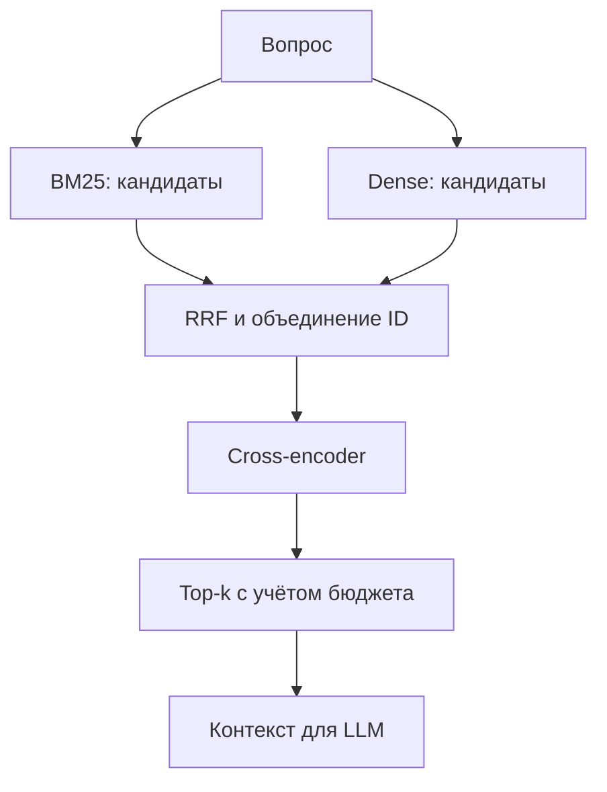

# 4. Реранкинг: повторное ранжирование и небольшие мультиязычные ранкеры

Материал для курса по ИИ. Все примеры — Python. Проверка документации: 30 октября 2026 года.

**Цель:** понять различие retrieval и reranking, использовать cross-encoder, объединять BM25 с dense retrieval и оценивать выигрыш. Код: `ranking.py`, `evaluate.py` и `rag_demo.py` в общем проекте.

## 1. Зачем повторно ранжировать

Первый поисковый этап должен быстро найти кандидатов среди большого корпуса. Он может путать тексты, похожие по теме, но отвечающие на разные вопросы.

Например, на вопрос «Когда вернут деньги на карту?» поиск нашёл:

- Как подать заявление о возврате товара.
- Сколько времени занимает зачисление денег.
- Какие карты принимаются для оплаты.

Все три фрагмента тематически близки. Для ответа важнее второй. **Reranking** повторно оценивает уже найденные кандидаты и меняет их порядок. [1]

Ранкер не обязан быть нейросетью: повторный порядок можно вычислять по бизнес-правилам или обученной модели с признаками. В этом материале основной вариант — нейросетевой cross-encoder.

**Он не возвращает документы, которых нет среди кандидатов.** Если нужный фрагмент потерян на первом этапе, переупорядочивание списка его не восстановит.

## 2. Retriever и reranker

| Свойство | Retriever с bi-encoder | Reranker с cross-encoder |
|---|---|---|
| Вход модели | Запрос и документы отдельно | Пара «запрос, документ» |
| Выход | Независимые векторы | Оценка пары |
| Можно заранее обработать документы? | Да | Нельзя заранее вычислить score для ещё неизвестного запроса |
| Поиск по большой базе | Подходит | Обычно слишком дорог для полного перебора |
| Типичная область применения | Получение кандидатов | Уточнение порядка небольшой выдачи |

В cross-encoder токены запроса и документа участвуют в совместном вычислении. Это даёт возможность учитывать точные взаимодействия между частями текста, которые теряются при сведении каждого текста к независимому вектору. Но выигрыш в качестве зависит от обучения, языка и задачи. [1]

Если корпус содержит миллион chunks, bi-encoder считает один новый query-вектор и использует индекс. Cross-encoder для полного корпуса потребовал бы миллион пар. Поэтому на практике ему передают, например, 20–100 кандидатов; это стартовый диапазон для эксперимента, не обязательное число.

## 3. Компактная мультиязычная модель для курса

Основная модель:

[**cross-encoder/mmarco-mMiniLMv2-L12-H384-v1**](https://huggingface.co/cross-encoder/mmarco-mMiniLMv2-L12-H384-v1).

- Примерно 118 млн параметров.
- Обучение на мультиязычном mMARCO, полученном переводом MS MARCO; русский представлен.
- В примере установлен лимит 512 токенов на **всю пару**, включая служебные токены.
- Возвращает score релевантности, а не embedding документа.
- Поддерживается `sentence_transformers.CrossEncoder`; возможен запуск на CPU. [2, 3]

Данная модель выбрана как компактный и простой baseline. Это не утверждение, что она лучшая современная модель для русского поиска.

Ещё один вариант для сравнения — [jinaai/jina-reranker-v2-base-multilingual](https://huggingface.co/jinaai/jina-reranker-v2-base-multilingual), около 278 млн параметров. Он больше основного варианта, но всё ещё существенно меньше миллиардных моделей. Карточка описывает обработку длинного входа скользящим окном, собственный код и лицензию CC-BY-NC-4.0. Поэтому он не включён в основной runnable-пример и требует отдельной проверки условий использования и загрузки кода. [4]

Не следует заменять эти модели на `ms-marco-MiniLM-*` только из-за слова MiniLM: обычные модели MS MARCO без мультиязычного обучения нельзя автоматически считать подходящими для русского.

## 4. Минимальный пример на Python

```bash
python -m pip install sentence-transformers
```

```python
import torch
from sentence_transformers import CrossEncoder

ranker = CrossEncoder(
    'cross-encoder/mmarco-mMiniLMv2-L12-H384-v1',
    device='cpu',
    max_length=512,
    activation_fn=torch.nn.Identity(),
)
query = 'Когда вернут деньги на карту?'
texts = [
    'Заявление на возврат товара оформляется в личном кабинете.',
    'После одобрения возврата деньги поступают на карту за 5 рабочих дней.',
    'Оплатить заказ можно банковской картой.',
]
scores = ranker.predict(
    [(query, text) for text in texts],
    batch_size=8,
    show_progress_bar=False,
)
for text, score in sorted(zip(texts, scores), key=lambda pair: -pair[1]):
    print(float(score), text)
```

Здесь явно выбрана Identity activation, чтобы получать необработанные scores. Точные значения и порядок нужно измерить; они не зафиксированы в тексте как якобы полученный результат. [5]

Для этого ранкера **больше score — выше место в выдаче**. Отрицательное значение допустимо. В других моделях интерфейс может возвращать logits нескольких классов или уже преобразованную оценку: проверяйте model card.

## 5. Почему score не является вероятностью истины

Модель обучалась различать более и менее релевантные пары. Её score отражает выученную задачу, а не универсальную вероятность «документ верный».

Даже применение sigmoid:

\[
\sigma(s)=\frac{1}{1+e^{-s}}
\]

лишь переводит число в диапазон `(0,1)` и сохраняет порядок. Оно не делает оценку откалиброванной вероятностью релевантности и тем более истинности.

Фраза «cosine 0.83, BM25 9.2 и reranker 4.7» содержит три разных шкалы. Их нельзя напрямую складывать без обоснованной нормализации или обучения комбинации.

Для допуска ответа по порогу нужны отдельные примеры с ответом и без ответа, выбор порога на валидационной выборке и измерение ошибок на тестовой. В демонстрации жёсткого порога нет: система показывает ранжирование, а не гарантирует возможность ответа.

## 6. Ограничение длины пары

Лимит 512 в cross-encoder — не «512 для вопроса плюс 512 для документа». Это общий бюджет. Если вопрос занимает 80 токенов, документу остаётся меньше 432 с учётом служебных токенов.

При слишком длинном входе токенизатор обрежет часть текста. Релевантный абзац в конце может не участвовать в оценке. Возможные решения:

- Подавать chunks, а не целые длинные документы.
- Ограничивать длину запроса и проверять итоговую токенизацию.
- Для длинного документа ранжировать окна, затем агрегировать оценки.
- Выбрать модель с большим контекстом и измерить стоимость.

Максимум scores по окнам тоже не нейтрален: длинный документ получает больше попыток найти высокую оценку. Агрегацию нужно проверять на разметке.

## 7. Гибридный поиск и RRF

BM25 и dense retrieval могут находить разные полезные документы. Чтобы объединить выдачи, используется **fusion**. Это отдельный этап: RRF сам не читает тексты и не вызывает ранкер.

Reciprocal Rank Fusion использует позиции, а не исходные scores:

\[
RRF(d)=\sum_{L:d\in L}\frac{1}{c+rank_L(d)}.
\]

Позиции считаются с 1. `c` сглаживает различие между высокими и низкими позициями; часто начинают с 60. Ширина входных списков и `c` — настройки, которые могут влиять на качество. [6]

Пример:

| Документ | BM25 | Dense | При `c=60` |
|---|---:|---:|---:|
| A | 1 | Нет | `1/61` |
| B | 2 | 1 | `1/62 + 1/61` |
| C | Нет | 2 | `1/62` |

B выйдет первым за счёт присутствия в обеих выдачах. RRF не доказывает его релевантность: оба поиска могут ошибаться одинаково.

### Реализация

```python
from collections import defaultdict


def fuse(rankings, c=60):
    scores = defaultdict(float)
    for ranking in rankings:
        # Внутри одного списка ID должны быть уникальными.
        for rank, doc_id in enumerate(dict.fromkeys(ranking), start=1):
            scores[doc_id] += 1 / (c + rank)
    return sorted(scores.items(), key=lambda pair: (-pair[1], pair[0]))


print(fuse([['A', 'B'], ['B', 'C']]))
```

В проекте функция `rrf` принимает списки `(id, score)`, но сами значения score не использует. Дубликаты одного ID не должны увеличивать вес внутри одной выдачи.

## 8. Полный маршрут: BM25 + dense → RRF → reranker



Для маленького корпуса из 12 документов используем небольшие числа. Внутри каталога проекта:

```python
from corpus import DOCS
from lexical import BM25
from dense import DenseSearch
from ranking import Reranker, rrf

bm25 = BM25(DOCS)
dense = DenseSearch(DOCS)
reranker = Reranker()

query = 'Когда деньги придут обратно на карту?'
candidates = rrf(
    [bm25.search(query, k=8), dense.search(query, k=8)],
    k=10,
)
final = reranker.rank(query, candidates, k=5)
print(final)
```

В сервисе объекты моделей создаются один раз при старте, а не заново для каждого вопроса. Векторы документов тоже не следует пересчитывать при каждом запросе; учебный скрипт делает это на старте для прозрачности.

Уменьшение списка перед reranker снижает стоимость, но может потерять полезные кандидаты. Увеличение списка повышает шанс включить их, но не гарантирует более хороший итоговый ответ.

## 9. Как оценить реранкер отдельно

Сначала зафиксируйте один и тот же набор кандидатов для каждого вопроса. Сравните порядок до и после ранкера. Иначе невозможно понять, улучшился reranker или просто первый этап стал находить больше документов.

Для бинарной разметки:

\[
Recall@k=\frac{|Top_k\cap Relevant|}{|Relevant|}.
\]

\[
RR@k=
\begin{cases}
1/r,&\text{если первый релевантный результат на позиции }r\le k;\\
0,&\text{если релевантных в top-k нет.}
\end{cases}
\]

MRR@k — средний RR@k по запросам.

Для градуированной релевантности:

\[
DCG@k=\sum_{i=1}^{k}\frac{2^{rel_i}-1}{\log_2(i+1)},\qquad
nDCG@k=\frac{DCG@k}{IDCG@k}.
\]

`IDCG` — DCG идеального порядка. В учебном коде релевантность бинарная, поэтому gain равен 0 или 1. Для запросов без релевантных документов эти функции намеренно не используются: отказ оценивается отдельно.

Важно различать `Recall@50` кандидатов и `Recall@5` финального списка. Ранкер способен повысить второй, переместив полезный документ наверх, но не может исправить отсутствие документа среди 50 кандидатов.

### Запуск оценки

```bash
python evaluate.py
python evaluate.py --neural
```

Первая команда сравнивает BM25 и TF-IDF. Вторая добавляет dense, RRF и RRF+reranker. Корпус игрушечный; вывод предназначен для понимания метрик, не для выбора победителя среди моделей.

## 10. Практические ошибки

| Ошибка | Последствие |
|---|---|
| Передавать только scores, без текста пары | Cross-encoder не получает нужный вход |
| Добавлять E5-префиксы любому ранкеру | Формат может не соответствовать обучению |
| Подавать embedding-векторы вместо текста | Это другой интерфейс и другая задача |
| Ранжировать весь большой корпус | Очень высокая стоимость |
| Считать sigmoid вероятностью правильного ответа | Неверные решения по порогу |
| Отрезать ID при сортировке | Потеря связи с источником |
| Отправлять закрытые тексты внешнему ранкеру до фильтрации | Нарушение границ доступа |
| Оценивать только приятные примеры | Неизвестное качество на реальных запросах |

## 11. Практикум

1. Для каждого запроса сохраните кандидатов BM25 и dense по ID.
2. Объедините их через RRF и сохраните финальный набор до ранкера.
3. Сравните порядок до и после cross-encoder на одних кандидатах.
4. Найдите минимум три случая ухудшения или неоднозначности.
5. Уберите релевантный документ из кандидатов и покажите, что ранкер его не восстанавливает.
6. Измерьте время для 10, 30 и 100 пар одинаковой типичной длины. Прогрев модели отделите от измерений.
7. Дополнительно: сравните компактный mMiniLM с более крупным мультиязычным ранкером на собственном тестовом наборе.

**Что сдать:** Recall кандидатов, MRR/nDCG финальной выдачи, задержки, модель и revision, описание длин входов и примеры ошибок. Результаты без этих условий плохо воспроизводимы.

## Результат контрольного запуска

На девяти учебных запросах с одним целевым фрагментом получены следующие значения. Это реальный запуск примеров на CPU, но не репрезентативное сравнение моделей.

| Метод | Recall@5 | MRR@5 | nDCG@5 |
|---|---:|---:|---:|
| BM25 | 0.667 | 0.667 | 0.667 |
| TF-IDF | 0.667 | 0.667 | 0.667 |
| E5 dense | 1.000 | 0.944 | 0.959 |
| RRF | 1.000 | 0.787 | 0.840 |
| RRF + mMiniLM reranker | 1.000 | 0.944 | 0.959 |

При этих настройках fusion ухудшил порядок относительно dense. Ранкер улучшил порядок RRF, но не превзошёл dense по приведённым метрикам. Значит, на данном наборе дополнительная стоимость всей цепочки не подтверждена улучшением этих метрик относительно одного dense. На другом корпусе результат может измениться.

В корпусе специально есть перефразирования и межъязыковые вопросы, а лексический анализатор примитивен. Это объясняет устройство задания и ограничивает обобщения. Версии и revisions записаны в `VALIDATION.md` и `validation-results.json`.

## Источники

1. [Sentence Transformers: Retrieve & Re-Rank](https://www.sbert.net/examples/sentence_transformer/applications/retrieve_rerank/README.html).
2. [mmarco-mMiniLMv2-L12-H384-v1](https://huggingface.co/cross-encoder/mmarco-mMiniLMv2-L12-H384-v1).
3. [Конфигурация mMiniLM cross-encoder](https://huggingface.co/cross-encoder/mmarco-mMiniLMv2-L12-H384-v1/blob/main/config.json).
4. [jina-reranker-v2-base-multilingual](https://huggingface.co/jinaai/jina-reranker-v2-base-multilingual).
5. [CrossEncoder API](https://sbert.net/docs/package_reference/cross_encoder/model.html).
6. [Reciprocal Rank Fusion](https://www.elastic.co/docs/reference/elasticsearch/rest-apis/reciprocal-rank-fusion).

Числовой RRF-пример и код — авторские учебные иллюстрации. Статус запуска нейросетевых примеров указан в README проекта.
